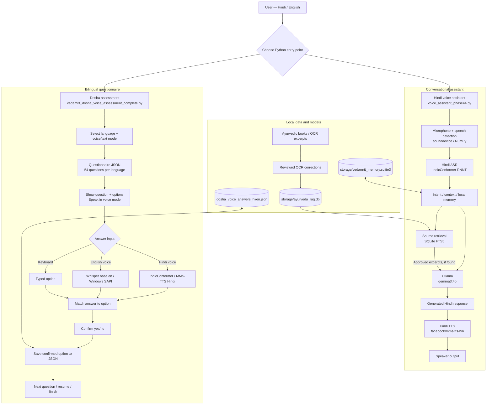

# 🌿 VedAmrit — Offline-First Ayurvedic AI Voice Assistant

> **Ancient wisdom, modern voice interaction.** A Python prototype combining local AI, Ayurvedic knowledge retrieval, and a bilingual, 54-question Dosha assessment.

    

**Repository:** https://github.com/deepaksen2006/Vedamrit_voice_assistant

## Table of contents

- [Overview](#overview)
- [Features and status](#features-and-status)
- [System architecture](#system-architecture)
- [Technology stack](#technology-stack)
- [Pretrained AI models](#pretrained-ai-models)
- [How VedAmrit works](#how-vedamrit-works)
- [Bilingual Dosha assessment](#bilingual-dosha-assessment)
- [Ayurvedic RAG pipeline](#ayurvedic-rag-pipeline)
- [Project structure](#project-structure)
- [Getting started](#getting-started)
- [Usage examples](#usage-examples)
- [Troubleshooting](#troubleshooting)
- [Privacy, safety, and limitations](#privacy-safety-and-limitations)
- [Roadmap](#roadmap)
- [Credits](#credits)

## Overview

**VedAmrit** is an **offline-first Ayurvedic educational voice assistant** developed in Python for Windows. It explores integrating automatic speech recognition (ASR), locally hosted large language models (LLMs), text-to-speech (TTS), and retrieval-augmented generation (RAG) over reviewed Ayurvedic source excerpts.

The repository currently contains **two independently runnable experiences**:

1. **Hindi conversational voice assistant:** listens to spoken Hindi, maintains conversation context and selected user preferences, optionally retrieves vetted excerpts from a local Ayurvedic database, asks Ollama's Gemma 3 model for a response, and speaks in Hindi.
2. **Bilingual Dosha assessment:** asks 54 questions in **Hindi or English** in **voice or text mode**, confirms each answer, saves progress automatically, and resumes unfinished sessions.

> **Important:** The existing prototype is not a medical diagnostic service. The voice questionnaire saves selected answers but does **not yet calculate or clinically validate a final Dosha score**. An Android/web application and integrated graphical front end are future work.

## Features and status

| Feature | Status | Implementation |
| --- | --- | --- |
| Hindi audio input | ✅ Implemented | 16 kHz microphone capture with `sounddevice` and NumPy |
| Speech/silence detection | ✅ Implemented | RMS threshold-based recording and end-of-speech handling |
| Hindi speech recognition | ✅ Implemented | AI4Bharat IndicConformer RNNT |
| English speech recognition for assessment | ✅ Implemented | `faster-whisper` with `base.en` |
| Hindi audio responses | ✅ Implemented | `facebook/mms-tts-hin` |
| Spoken English assessment questions/options | ✅ Implemented | Windows `System.Speech` with speed fixed to **2** |
| Conversational local LLM | ✅ Implemented | Ollama `gemma3:4b` |
| Conversation context and preferences | ✅ Implemented | Context manager, SQLite-backed persistent memory |
| Ayurvedic source retrieval | ✅ Implemented, requires local DB | SQLite FTS5 with verified review/hash checks |
| Questionnaire languages | ✅ Implemented | Hindi and English, 54 questions each |
| Assessment modes | ✅ Implemented | Terminal prompts for `voice` / `text` |
| Spoken choices + yes/no confirmation | ✅ Implemented | Language-aware option recognition |
| Resume and save | ✅ Implemented | Separate local JSON answer files |
| Final Dosha scoring or diet plan output | 🚧 Not integrated | Questionnaire script records answers only |
| Unified GUI / mobile application | 📌 Planned | Current working interfaces are Python console flows |

## System architecture

### Architecture diagram (PNG)


> **Image:** [View full-size system architecture](docs/architecture.png). The diagram illustrates the two current Python entry points, language-specific speech models, Ollama generation, locally reviewed SQLite FTS5 retrieval, and saved assessment answers.

### Editable architecture (Mermaid)

The following diagram is rendered automatically by GitHub using **Mermaid**. It reflects the current prototype's separate conversational and assessment entry points, the local LLM, and the verified SQLite FTS5 retrieval path.



### Architecture layers

| Layer | Responsibility | Technologies |
| --- | --- | --- |
| Input | Microphone speech or keyboard choice | `sounddevice`, NumPy, Python console |
| Speech recognition | Convert microphone input into text | IndicConformer (Hindi); Whisper `base.en` (English assessment) |
| Controller | Run dialogue and question/answer workflow | Python modules |
| Memory/context | Recent conversational turns and explicit preferences | Context manager, SQLite |
| Knowledge retrieval | Retrieve reviewed Ayurvedic OCR passages | SQLite FTS5, BM25, SHA-256 check |
| Generation | Generate natural-language responses | Ollama + `gemma3:4b` |
| Speech output | Speak responses and options | MMS-TTS Hindi; Windows `System.Speech` English |
| Storage | Save answers and reference information | JSON, SQLite |

**Architectural distinction:** The retrieval mechanism is **SQLite FTS5 full-text search**, not FAISS or a vector database. The current main voice-assistant conversation is primarily **Hindi**; bilingual voice support is demonstrated in the **Dosha assessment**.

## Technology stack

| Category | Technology | Role |
| --- | --- | --- |
| Programming | Python | Orchestration and application logic |
| Local model server | Ollama | Serves the LLM locally |
| Conversational model | Google Gemma 3 4B (`gemma3:4b`) | Natural-language responses |
| Hindi ASR | AI4Bharat IndicConformer | Hindi audio transcription |
| English ASR | OpenAI Whisper (`base.en`) via `faster-whisper` | English spoken questionnaire answers |
| ML runtime | PyTorch | Running Hindi speech models |
| Model library | Hugging Face `transformers` | Loading ASR and Hindi TTS models |
| Hindi TTS | Meta `facebook/mms-tts-hin` | Hindi voice generation |
| English TTS | Windows `System.Speech` / PowerShell | English question and option reading |
| Audio | `sounddevice`, NumPy | Microphone capture, RMS calculation, playback |
| Retrieval | SQLite FTS5, BM25 | Local indexed source search |
| Memory | SQLite | Persistent facts and preferences |
| Questionnaire | JSON | Bilingual questions and confirmed responses |
| Developer tooling | VS Code, Git, GitHub | Development and version control |

## Pretrained AI models

| Identifier | Origin | Purpose | Source file |
| --- | --- | --- | --- |
| `ai4bharat/indic-conformer-600m-multilingual` | AI4Bharat | Hindi speech recognition | `backend/voice_assistant_phase44.py` |
| `base.en` (Whisper) | OpenAI; executed using faster-whisper | English speech recognition in assessment | `backend/vedamrit_dosha_voice_assessment_complete.py` |
| `gemma3:4b` | Google / Ollama package | Local conversational LLM | `backend/voice_assistant_phase44.py` |
| `facebook/mms-tts-hin` | Meta | Offline Hindi TTS | `backend/offline_tts.py` |

The repository also contains **`Modelfile.vedamrit` referencing `qwen3:4b`**. That is an alternative/experimental configuration, **not** the model set by the active Phase 4.4 voice assistant, which uses `gemma3:4b`.

These are **externally pretrained models** integrated for inference; this project does not claim to train them from scratch.

## How VedAmrit works

### A. Hindi conversational voice assistant

1. Record mono audio at **16 kHz**, with threshold-based voice start/end detection.
2. Transcribe the spoken Hindi sentence with IndicConformer RNNT.
3. Manage dialogue context, simple intents and explicit saved preferences.
4. For Ayurvedic questions, attempt to retrieve approved passages from `storage/ayurveda_rag.db`.
5. Send context and available excerpts to Ollama's `gemma3:4b` model.
6. Normalize the answer and play it through Meta MMS-TTS Hindi.

Retrieval does not guarantee that the LLM will always answer correctly; review and citation checking remain important.

### B. Bilingual Dosha questionnaire

1. Select **Hindi (`hi`)** or **English (`en`)**.
2. Select **voice** or **text** mode.
3. VedAmrit displays the question and options; in voice mode, it reads **every option aloud**.
4. In Hindi voice mode, IndicConformer recognizes spoken options and MMS-TTS speaks questions.
5. In English voice mode, Whisper `base.en` recognizes spoken options and Windows `System.Speech` reads questions.
6. The selected option is repeated back for **yes/no confirmation**.
7. Confirmed answers are saved immediately; previously confirmed answers are skipped on restart.
8. When 54 responses are complete, the questionnaire finishes and retains the recorded selections.

The script handles repeat/stop commands and offers a typed fallback if voice input repeatedly fails.

## Bilingual Dosha assessment

| Section | Questions per language | Description |
| --- | ---: | --- |
| Prakriti | 21 | Constitutional characteristics |
| Vikriti | 21 | Current symptom/imbalance-related characteristics |
| Agni | 11 | Digestive-function questions |
| Diet duration | 1 | Choose 1-day or 7-day duration |
| **Total** | **54** | **54 Hindi + 54 English** |

The number of choices varies by question; not all questions have three options. The assessment answers are stored as local files such as `backend/dosha_voice_answers_hi.json` and `backend/dosha_voice_answers_en.json`.

**Scoring:** The current script saves `option_index`, `option_number`, and `option_text`. It **does not calculate** Prakriti/Vikriti/Agni scores, final Dosha type, or diet recommendations; any existing text-assessment scoring code would require separate integration and validation.

## Ayurvedic RAG pipeline

The project includes utilities for extracting, processing, auditing, correcting and reviewing OCR text from Ayurvedic literature, including sources such as **Charaka Samhita** and **Sushruta Samhita**.

At query time, `backend/search_rag.py` searches the local SQLite database at `storage/ayurveda_rag.db` using **FTS5** and term matches. By default (`verified_only=True`), retrieved passages must satisfy all of the following:

- Chunk marked verified;
- Correction status `VERIFIED`;
- Reviewer decision `APPROVED`;
- Corrected text present;
- SHA-256 of correction matches its stored reviewed hash.

The result includes source title and PDF page citation. **OCR review establishes that the passage was checked against source material, not that the medical claim is scientifically validated.**

> **Data caution:** The reviewed RAG database is a local prerequisite and may be absent from a fresh clone. If missing, RAG retrieval is unavailable. **Do not run `backend/build_rag_index.py` over an existing reviewed database** without backups and a careful review, because rebuilding may discard review/verification associations.

## Project structure

Simplified source tree; virtual environments, caches, model weights and large OCR outputs are omitted:

```text
Vedamrit_voice_assistant/
├── .gitignore
├── Modelfile.vedamrit
├── backend/
│   ├── voice_assistant_phase44.py           # Hindi conversational controller
│   ├── vedamrit_dosha_voice_assessment_complete.py
│   ├── vedamrit_dosha_questions_bilingual.json
│   ├── vedamrit_dosha_voice_engine.py
│   ├── offline_tts.py                      # MMS Hindi TTS
│   ├── search_rag.py                       # SQLite FTS5 search
│   ├── context_manager.py
│   ├── persistent_memory.py
│   ├── natural_hindi.py
│   ├── speech_clarification.py
│   ├── microphone_test.py
│   ├── test_microphone.py
│   ├── ocr_books.py
│   ├── full_book_ocr.py
│   ├── audit_ocr.py
│   ├── review_ai_corrections.py
│   ├── verify_rag.py
│   └── ...                                  # Development versions and utilities
├── books/                                  # Optional reference PDFs
└── storage/                                # Local databases, OCR and review data
```

## Getting started

### Prerequisites

- Windows computer (the English TTS implementation calls Windows `System.Speech`).
- Compatible Python installation and sufficient disk space/RAM for AI models.
- Working microphone and speakers for voice modes.
- [Ollama](https://ollama.com/) installed for the conversational assistant.
- Internet connection for **first-time model downloads**. Once model files are installed, model inference and local database operations can be performed offline.

### 1. Clone

```powershell
git clone https://github.com/deepaksen2006/Vedamrit_voice_assistant.git
cd Vedamrit_voice_assistant
```

### 2. Python environment

```powershell
py -m venv .venv-1
.\.venv-1\Scripts\Activate.ps1
python -m pip install --upgrade pip
```

### 3. Install core libraries

```powershell
python -m pip install numpy sounddevice torch transformers ollama faster-whisper
```

This command reflects current imports but is **not a tested, version-pinned lockfile**. Additional dependencies may be needed for your Python/PyTorch build and specific Hugging Face models.

### 4. Set up the local LLM

```powershell
ollama pull gemma3:4b
ollama list
```

Make sure the Ollama server is running before starting the conversational assistant. On some installations it can be started with `ollama serve`.

### 5. Run the Hindi conversational assistant

```powershell
python backend\voice_assistant_phase44.py
```

On first use, Transformers may download IndicConformer and MMS-TTS weights. The assistant requires access to the Windows microphone and audio output.

### 6. Run the Dosha assessment

```powershell
python backend\vedamrit_dosha_voice_assessment_complete.py
```

English voice mode:

```text
Language (hi/en): en
Mode (voice/text): voice
```

Hindi voice mode:

```text
Language (hi/en): hi
Mode (voice/text): voice
```

English text mode:

```text
Language (hi/en): en
Mode (voice/text): text
```

**English speaking rate is fixed at `2`** in the current Python assessment script; there is no speed-selection prompt.

### 7. Optional: check local RAG data

If you already have the reviewed local database:

```powershell
python backend\search_rag.py "वात पित्त कफ"
```

If `storage/ayurveda_rag.db` is missing, retrieval will not work until the reviewed database is safely restored or prepared.

## Usage examples

### Hindi assistant

```text
User: नमस्ते
VedAmrit: नमस्ते!
User: आयुर्वेद में वात, पित्त और कफ क्या हैं?
VedAmrit: [A generated Hindi response; may use approved retrieved text]
```

### English voice assessment

```text
VedAmrit: Question 1. How would you describe your skin texture?
VedAmrit: Option 1. Dry/rough skin; absorbs oils quickly.
VedAmrit: Option 2. Soft, supple, warm skin; ...
VedAmrit: Option 3. Oily, clear skin; ...
VedAmrit: Please say your option number.
User (speaks): Option two.
VedAmrit: You selected option 2. Is that correct? Say yes or no.
User (speaks): Yes.
[SAVED] prakriti:1: option 2 (1/54)
```

These transcripts illustrate the **expected workflow**, not benchmarked speech-recognition accuracy.

## Troubleshooting

| Issue | Suggested check |
| --- | --- |
| Microphone not detected | Check Windows microphone permissions and correct audio input; run `python backend\test_microphone.py` |
| No voice captured | Speak after the listening prompt, check microphone level and RMS output |
| Hindi model does not load | Check first-time network access, memory, and PyTorch/Transformers compatibility |
| English text displays but speech is silent | Verify Windows `System.Speech` and the selected speaker output |
| English spoken answer is unclear | Install `faster-whisper`, confirm `base.en` cache, say “option two” clearly |
| Wrong recognized option | Repeat the full phrase; use fallback keyboard option after repeated failures |
| RAG database missing | Restore the approved `storage/ayurveda_rag.db`; do not overwrite reviewed data |
| Ollama connection error | Start Ollama and check `ollama list` for `gemma3:4b` |
| Assessment starts at question 2+ | Previously confirmed answers are skipped intentionally; progress was saved |

## Privacy, safety, and limitations

- **Educational use only.** Not a clinically validated diagnostic tool, licensed medical service, or treatment provider.
- **No prescribing.** Do not rely on generated text for medication, treatment, or urgent health decisions; consult a qualified professional.
- **AI can be wrong.** Speech recognition, OCR, retrieved text, and generated responses may contain errors.
- **Reviewed OCR is not medical validation.** Review status pertains to source-text consistency and approval, not efficacy of traditional claims.
- **Not fully bilingual conversational chat.** The implemented **assessment** supports Hindi and English; the Phase 4.4 conversation is Hindi-focused.
- **Not a production UI.** The demonstrated working programs run in the terminal; an integrated GUI/web/mobile experience remains future work.
- **Local privacy.** Saved answers, audio, preferences and databases may contain personal information. Keep those outside public repositories and avoid committing credentials.
- **Model distribution and source copyrights.** Review applicable licensing for AI models and book scans/OCR content before redistribution.
- **Offline-first, not offline initial setup.** Network access is generally required to download models initially.

## Roadmap

- Unified on-screen selection between voice-based and text-based assessment.
- Integrate reviewed scoring rules for Prakriti, Vikriti and Agni, with understandable explanations.
- Improve speech recognition for short one-word answers.
- Reproducible dependency lockfile, tests and onboarding instructions.
- Safe distribution/setup of reviewed Ayurvedic RAG data.
- Optional graphical or mobile user interface.
- Additional safeguards, clear source citations and clinical review before health-oriented deployment.

## Credits

VedAmrit integrates pretrained technologies developed by **AI4Bharat** (IndicConformer), **OpenAI** (Whisper), **Google** (Gemma), and **Meta** (MMS-TTS), alongside **Ollama**, **PyTorch**, **Hugging Face Transformers**, **SQLite**, and the Python open-source ecosystem.

Original model and third-party licenses remain applicable; this repository's existence does not imply ownership of those models or texts.

---

**Project:** VedAmrit — Offline-First Ayurvedic AI Voice Assistant  
**Maintainer:** [deepaksen2006](https://github.com/deepaksen2006)  
**Source:** [GitHub](https://github.com/deepaksen2006/Vedamrit_voice_assistant)  
**Status:** Research and development prototype
